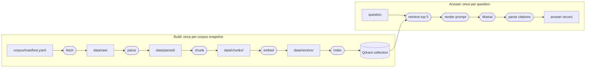

# Architecture

Hangar's code is a set of small stages that read files and write files, with every external service behind an interface. This page describes the rules the code follows and how data moves through it. Each stage section is filled in by the issue that builds the stage.

## Principles

1. **Stages are functions over artifacts.** Each stage reads its inputs, writes new outputs and never modifies its inputs, so a rerun gives the same result.
2. **Domain types sit at the centre and do no I/O.** Documents, passages, chunks and answers are validated data objects.
3. **External systems sit behind small interfaces.** Qdrant, Mistral, Hugging Face and HTTP downloads are reached through interfaces, and tests swap them for fakes.
4. **A variant is a configuration file, not a code branch.** Nothing in the code asks which version it is running.
5. **Every artifact records where it came from:** the configuration hash, the commit, the input hashes and the model revisions.
6. **Identifiers derive from content and location,** never from the order of a run.
7. **Validation happens at every boundary,** with error messages that name the file and the field.
8. **An interface exists only where a named later version needs it.** Notebooks never write artifacts.

## Data flow

v0 has five build stages, each writing one artifact, and one answering path that reads the index. The build runs once per corpus snapshot. The answering path runs once per question.



Rounded boxes are steps; square boxes are the files they read and write. Each build stage reads only the previous artifact, so the embed stage can run on a borrowed notebook GPU and hand back its vectors file, while the other stages stay on the laptop.

## Package layout and dependency rules

All the code lives in one package, `src/hangar/`, split by stage. A package folder is created when its first real file arrives, so most of the folders below don't exist yet.

| Package | Holds |
| --- | --- |
| `core` | Domain types, configuration models, identifiers, provenance, errors |
| `observability` | Logging set-up, run recorder, cost table |
| `files` | Reading the YAML files that configure Hangar, such as the manifest and the pipeline file |
| `corpus` | Manifest loading and validation, downloader, hash checks |
| `parsing` | FAA PDF pages, CAR XML, Transport Canada HTML, normalisation, parse report |
| `chunking` | Chunker interface, fixed-token chunker, token counter |
| `embedding` | Embedder interface, sentence-transformers adapter, hash embedder for tests |
| `indexing` | Vector index interface, Qdrant adapter, collection naming, index manifest |
| `retrieval` | Retriever interface, dense retriever |
| `generation` | Prompt rendering, LLM client interface, Mistral adapter, rate limiter, citations |
| `evaluation` | Seed set loading, scoring sheet export, summary |
| `pipelines` | The build, answer and seed-run pipelines, and the registry that turns configuration into objects |
| `cli` | The `hangar` command |

Dependencies point one way, from top to bottom:

```text
cli
└── pipelines
    └── retrieval
        └── corpus | parsing | chunking | embedding | indexing | generation | evaluation
            └── observability | files
                └── core
```

- `core` imports nothing else from `hangar` and does no I/O.
- `files` imports only `core`. It reads YAML files for the stages and `pipelines`, which then pass the content to `core` to validate.
- The stage packages import `core`, `observability` and `files`, never each other. The one exception is `retrieval`, which may use the embedding and indexing interfaces because it combines them.
- Adapters for Qdrant, Mistral, sentence-transformers and pypdfium2 live inside their stage package. Only `pipelines` constructs them, through a registry keyed by the type names in the configuration. Swapping one of them therefore touches one registry entry and one configuration file.
- `pipelines` imports the stages and `core`. `cli` imports only `pipelines` and `observability`.
- Every layer may use `observability`.

import-linter checks these rules in CI, through the contracts in `pyproject.toml`:

- **Layers:** the order above. Packages that don't exist yet are optional, so the contract already holds and starts checking each package as soon as it appears.
- **cli:** `cli` imports nothing but `pipelines` and `observability`.
- **Still to add:** the rule that limits `retrieval` to `embedding` and `indexing` (#23), and the rules that keep each adapter library inside its stage package and `pipelines` (#16, then #21, #22 and #25).

## Commands and logs

`hangar` has one subcommand per stage, plus `doctor`. Each takes `--config`, the pipeline file (`configs/pipelines/v0.yaml` by default). `cli` only parses the command line; `pipelines.commands` runs the command:

1. It reads the environment settings and starts a run with its own ID, such as `20261105T142233Z-3fa91c`: the start time in UTC and six random hex characters.
2. It reads the pipeline file and logs its path and configuration hash.
3. It runs the command and returns the exit code: 0 on success, 1 on failure.

Every record goes to two places: a JSON lines file, `<data folder>/logs/<run ID>.jsonl`, and the screen, as readable lines. Each record carries the run ID, the stage and the document being worked on. Code logs through the standard library (`logging.getLogger(__name__)`), and a `log_context` block in `observability.logs` supplies those three values, so the code that logs never passes them along.

The Mistral API key is replaced by `[REDACTED]` before any record is written, in messages, arguments and tracebacks alike, and in records from other libraries too. Errors are logged rather than left to print their own traceback, so they go through the same redaction.

`hangar doctor` checks Python 3.12 or later, Qdrant's `/readyz` endpoint, that `MISTRAL_API_KEY` is set (without calling the API), 2 GB of free space for the data folder, and that the pinned embedding model is in the Hugging Face cache or can be downloaded there. It reports each check as pass or fail, and exits with 1 if any fails.

## Stages

### Fetch

To be written in #13.

### Parse

To be written in #15 to #19.

### Chunk

To be written in #20.

### Embed

To be written in #21.

### Index

To be written in #22.

### Retrieve

To be written in #23.

### Generate

To be written in #24 to #28.

### Evaluate

To be written in #30 to #33.
