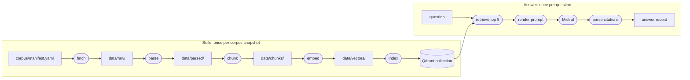

# Architecture

Hangar's code is a set of small stages that read files and write files, with every external service behind an interface. This page describes the rules the code follows and how data moves through it. Each stage section is filled in by the issue that builds the stage.

## Principles

1. **Stages are functions over artifacts.** Each stage reads its inputs, writes new outputs and never modifies its inputs, so a rerun gives the same result.
2. **Domain types sit at the centre and do no I/O.** Documents, passages, chunks and answers are validated data objects.
3. **External systems sit behind small interfaces.** Qdrant, Mistral, Hugging Face and HTTP downloads are reached through interfaces, and tests swap them for fakes.
4. **A variant is a configuration file, not a code branch.** Nothing in the code asks which version it is running.
5. **Every artifact records where it came from:** the configuration hash, the commit, the input hashes and the model revisions.
6. **Identifiers derive from content and location,** never from the order of a run.
7. **Validation happens at every boundary,** with error messages that name the file and the field.
8. **An interface exists only where a named later version needs it.** Notebooks never write artifacts.

## Data flow

v0 has five build stages, each writing one artifact, and one answering path that reads the index. The build runs once per corpus snapshot. The answering path runs once per question.



Rounded boxes are steps; square boxes are the files they read and write. Each build stage reads only the previous artifact, so the embed stage can run on a borrowed notebook GPU and hand back its vectors file, while the other stages stay on the laptop.

## Package layout and dependency rules

All the code lives in one package, `src/hangar/`, split by stage. A package folder is created when its first real file arrives, so most of the folders below don't exist yet.

| Package | Holds |
| --- | --- |
| `core` | Domain types, configuration models, identifiers, provenance, errors |
| `observability` | Logging set-up, run recorder, cost table |
| `files` | Reading the YAML files that configure Hangar, such as the manifest and the pipeline file |
| `corpus` | Manifest loading and validation, downloader, hash checks |
| `parsing` | FAA PDF pages, CAR XML, Transport Canada HTML, normalisation, parse report |
| `chunking` | Chunker interface, fixed-token chunker, token counter |
| `embedding` | Embedder interface, sentence-transformers adapter, hash embedder for tests |
| `indexing` | Vector index interface, Qdrant adapter, collection naming, index manifest |
| `retrieval` | Retriever interface, dense retriever |
| `generation` | Prompt rendering, LLM client interface, Mistral adapter, rate limiter, citations |
| `evaluation` | Seed set loading, scoring sheet export, summary |
| `pipelines` | The build, answer and seed-run pipelines, and the registry that turns configuration into objects |
| `cli` | The `hangar` command |

Dependencies point one way, from top to bottom:

```text
cli
└── pipelines
    └── retrieval
        └── corpus | parsing | chunking | embedding | indexing | generation | evaluation
            └── observability | files
                └── core
```

- `core` imports nothing else from `hangar` and does no I/O.
- `files` imports only `core`. It reads YAML files for the stages and `pipelines`, which then pass the content to `core` to validate.
- The stage packages import `core`, `observability` and `files`, never each other. The one exception is `retrieval`, which may use the embedding and indexing interfaces because it combines them.
- Adapters for Qdrant, Mistral, sentence-transformers and pypdfium2 live inside their stage package. Only `pipelines` constructs them, through a registry keyed by the type names in the configuration. Swapping one of them therefore touches one registry entry and one configuration file.
- `pipelines` imports the stages and `core`. `cli` imports only `pipelines` and `observability`.
- Every layer may use `observability`.

import-linter checks these rules in CI, through the contracts in `pyproject.toml`:

- **Layers:** the order above. Packages that don't exist yet are optional, so the contract already holds and starts checking each package as soon as it appears.
- **cli:** `cli` imports nothing but `pipelines` and `observability`.
- **Adapter libraries:** only `parsing` and `pipelines` import pypdfium2 and lxml. The contract checks every module of `hangar` and exempts those two, so a new package is checked from its first file.
- **Still to add:** the rule that limits `retrieval` to `embedding` and `indexing` (#23), and the same adapter rule for sentence-transformers, Qdrant and Mistral (#21, #22 and #25).

## Commands and logs

`hangar` has one subcommand per stage, plus `doctor`. Each takes `--config`, the pipeline file (`configs/pipelines/v0.yaml` by default). `cli` only parses the command line; `pipelines.commands` runs the command:

1. It reads the environment settings and starts a run with its own ID, such as `20261105T142233Z-3fa91c`: the start time in UTC and six random hex characters.
2. It reads the pipeline file and logs its path and configuration hash.
3. It runs the command and returns the exit code: 0 on success, 1 on failure.

Every record goes to two places: a JSON lines file, `<data folder>/logs/<run ID>.jsonl`, and the screen, as readable lines. Each record carries the run ID, the stage and the document being worked on. Code logs through the standard library (`logging.getLogger(__name__)`), and a `log_context` block in `observability.logs` supplies those three values, so the code that logs never passes them along.

The Mistral API key is replaced by `[REDACTED]` before any record is written, in messages, arguments and tracebacks alike, and in records from other libraries too. Errors are logged rather than left to print their own traceback, so they go through the same redaction.

`hangar doctor` checks Python 3.12 or later, Qdrant's `/readyz` endpoint, that `MISTRAL_API_KEY` is set (without calling the API), 2 GB of free space for the data folder, and that the pinned embedding model is in the Hugging Face cache or can be downloaded there. It reports each check as pass or fail, and exits with 1 if any fails.

## Stages

### Fetch

`hangar fetch` makes sure every active document of the snapshot is in `<data folder>/raw`, with the SHA-256 the manifest gives. It downloads only from the manifest's URLs.

1. It reads the manifest named by `corpus.manifest` and keeps the active documents of `corpus.snapshot`. Cancelled documents stay in the manifest but are never fetched. Each document is downloaded from its `source_url`. For Transport Canada pages, that is a fixed Wayback Machine snapshot, because the live pages' bytes change with the site's cache ([why](../corpus/c1-scope.md#where-the-transport-canada-pages-come-from)). `official_url` keeps the live page for citations.
2. Each document's file is named by its raw artifact ID, the document ID plus its format: `faa-h-8083-31b.pdf`, `car-sor-96-433.xml`, `tc-ac-571-002.html`.
3. A file already there with the right hash is kept, so a second run downloads nothing.
4. Otherwise the file is downloaded to `<ID>.part`, hashed as it streams to disk, and renamed only if its hash matches. A mismatch or a failed download stops the run, with an error that starts with the document ID. The files fetched before it are kept.
5. Each download is added to `data/logs/fetch-log.jsonl` as a raw artifact record: path, SHA-256, size, fetch time, and the server's `ETag` and `Last-Modified` headers. The log stays out of `data/raw`, so that folder holds only the documents and its hash in `dvc.lock` is the same on every machine.

The downloader is an interface with two versions:

- **`HttpDownloader`:** uses the standard library, with no extra dependency. It reads and hashes 1 MiB at a time, so the 205 MB Powerplant handbook never sits in memory. It sends a `User-Agent` that names Hangar and its repository, leaves at least one second between requests, and retries 429 and 5xx answers and network errors up to three times, waiting 2 then 4 seconds. Other answers, such as 404, fail at once.
  - It decodes gzip-encoded answers while they stream, at most 1 MiB at a time, so the file and its hash are those of the document itself. The Wayback Machine sends gzip even when asked for none.
  - It refuses any file larger than 1 GB once decoded. The largest C1 file is 215 MB.
- **`LocalCopyDownloader`:** copies local files instead, so tests never touch the network.

The `fetch` DVC stage depends on `corpus/manifest.yaml` and on the `corpus` section of the pipeline file. Its output, `data/raw`, has `cache: false`, because the documents are not Hangar's to store, and `persist: true`, so DVC doesn't delete the files before a rerun and fetch can skip them.

### Parse

The parse stage turns each downloaded file into one canonical text, split into passages: one per PDF page, or one per numbered section of a regulation, standard or advisory circular. [ADR-0005](adr/0005-locations-and-identifiers.md) explains these choices.

- **Canonical text.** `parsing.normalise` applies Unicode NFKC, turns every line ending into a plain newline, and collapses runs of spaces and tabs into one space, as `parsing.normalisation` in the pipeline file sets. Newlines stay, so paragraphs and list items stay apart.
- **Passages** (`core.parsed`) are character ranges of the canonical text, and cover it exactly once. `ParsedDocument` rejects gaps, overlaps, duplicate IDs, and passages that don't start at 0 or don't reach the end of the text.
- **Locations.** A page passage holds its 1-based index in the PDF, which is canonical, and the printed page label when the PDF has one. A section passage holds its label, such as `571.10`, and its heading path. The text before the first numbered section is a front-matter passage with no label.
- **IDs** derive from the document and the location: `faa-h-8083-31b#p142`, `car-sor-96-433#s571.10`, `tc-std-571#front`.
- **Assembly.** Every parser cuts its document into parts and hands them to `parsing.assemble`. It normalises and trims each part, then joins them with a blank line. Each passage includes the blank line that follows it, so the passages cover the text by construction. An empty page keeps a zero-length passage, so page numbers stay continuous.
- **From offsets to locations.** `ParsedDocument.passages_in_range(start, end)` returns the passages a range of the text covers. The chunker (M3) will use it to find a chunk's pages or sections. Empty passages hold no text, so no range covers them.
- **Parsers** follow the `parsing.parser.Parser` interface: a manifest entry and a downloaded file in, a parsed document out. Each records its name, the version of its library, the SHA-256 of the file it read, and its warnings, such as empty pages.

**PDF pages.** `parsing.pdf.PdfPageParser` reads the FAA handbooks with pypdfium2 ([ADR-0004](adr/0004-pypdfium2-for-pdf-text.md)):

- Each page gives one passage, with the text PDFium extracts, its 1-based index, and its printed label when the PDF has page labels. FAA-H-8083-31B has none.
- The text is kept as extracted, running headers and page numbers included. The only correction: PDFium returns a hyphen it joins across a line break as `U+FFFE`, and the parser puts the hyphen back.
- A page with no text gets an `empty_page` warning. A page with control, private-use or unassigned characters, such as a figure whose font has no Unicode mapping, gets a `garbled_page` warning. C1 gives 3 empty covers and 2 garbled pages.
- A file PDFium can't open raises a `ParseError` that starts with the document ID.

**CAR sections.** `parsing.car.CarXmlParser` reads the Justice Canada XML of the regulations with lxml:

- It keeps the sections whose label starts with one of `parsing.car.subparts`, 571 and 573 in v0, in document order: 31 sections, the partly repealed ones included. A configured subpart with no section is an error.
- Headings don't wrap their sections in this XML: `Heading` elements with a level from 1 to 5 sit next to the `Section` elements. A section's heading path is the latest heading at each level before it, such as `Part V — Airworthiness › Subpart 71 — Aircraft Maintenance Requirements › Maintenance Release`. A heading's history note stays out of it.
- A section's text starts with the headings that came after the previous section, so the canonical text keeps them in order. Then each `Text` becomes one line, led by the labels above it: `571.02 (1) …`, `(a) …`, `(i) …`. Cross-references stay inline, and the history note becomes a last line, as the consolidation prints it. Reserved ranges, such as 573.16 to 573.29, have no section and stay out.
- Entities are never resolved and nothing is fetched from the network, so a downloaded file can't make the parser read other files.

The Transport Canada HTML parser, the `hangar parse` command and the parse report are described as #18 and #19 add them.

### Chunk

To be written in #20.

### Embed

To be written in #21.

### Index

To be written in #22.

### Retrieve

To be written in #23.

### Generate

To be written in #24 to #28.

### Evaluate

To be written in #30 to #33.
